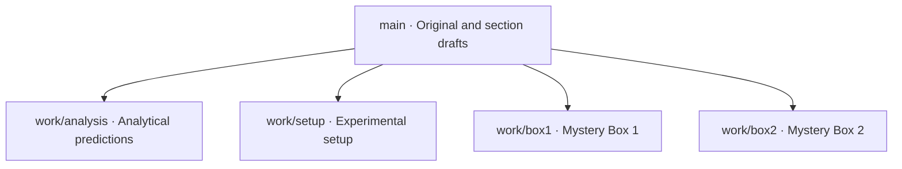

# Lab 5 Mystery Box Challenge — Group 35

Members: Tong Su, Carter Flynn Swanson, Zachary Kramer. Leader and task owners remain unassigned.

## Original Word Document

[Download the complete Group 35 Word document](original/ENGR202_Lab5_Group35.docx). The original content, images, tables, and formatting are preserved. No fabricated measurements have been added.

## Branch Tree

Four work branches start from the same baseline and retain their own revision histories. This diagram shows the branch structure. Visit [Branches](https://github.com/TONGSUOregonState/Lab5/branches) to view subsequent work.

| Work area | Questions | Editing location |
|---|---|---|
| Team information and background | Q1.1 | [Team information](sections/00-team-background.md) |
| Analytical predictions | Q3.1.1–Q3.1.3 | [Analysis branch](https://github.com/TONGSUOregonState/Lab5/tree/work/analysis/sections/01-analysis.md) |
| Setup and photographs | Q3.2.1 | [Setup branch](https://github.com/TONGSUOregonState/Lab5/tree/work/setup/sections/02-setup.md) |
| Mystery Box 1 | Q3.3.1–Q3.3.12 | [Box 1 branch](https://github.com/TONGSUOregonState/Lab5/tree/work/box1/sections/03-box1.md) |
| Mystery Box 2 | Q3.4.1–Q3.4.12 | [Box 2 branch](https://github.com/TONGSUOregonState/Lab5/tree/work/box2/sections/04-box2.md) |

## Workflow

1. Open your work branch and edit the corresponding file in `sections`. Replace TODO placeholders with calculations, responses, and evidence links. Team members decide task ownership.
2. Place photographs and oscilloscope screenshots in `evidence/setup`, `evidence/box1`, or `evidence/box2`. Place LTspice files in the matching `simulations` directory.
3. Commit each completed portion with a clear description of the changes.
4. Open a pull request from your work branch to `main` for review and merging. Changes to separate text sections may merge automatically; overlapping conflicts require manual resolution.
5. Transfer the reviewed content into the original Word template and save the final report in `final`. Automatic Word generation and merging are not configured.

## Submission Checklist

- [ ] Complete the group leader, date, and full lab title
- [ ] Show analytical derivations and identify extra-credit work
- [ ] Include setup photographs and the TinkerCAD layout
- [ ] Include both cursor screenshots and measurement windows for each box
- [ ] Record three actual test frequencies, voltage phasors, component types, and values for each box
- [ ] Show component calculations and verification by substitution
- [ ] Explicitly compare LTspice amplitude ratios and phases with experimental measurements
- [ ] Complete the frequency tables and discussions for both boxes
- [ ] Check images, equations, tables, and pagination in the final Word report

The section files are mergeable Markdown drafts, not four separate Word documents. Refer to the complete Word document in `original` for figures and original formatting. The supplied template contains apparent typos, including references to Box #1 in Q3.4.8 and Q3.4.10. Extracts preserve the original wording; verify these references against their section before submission.
