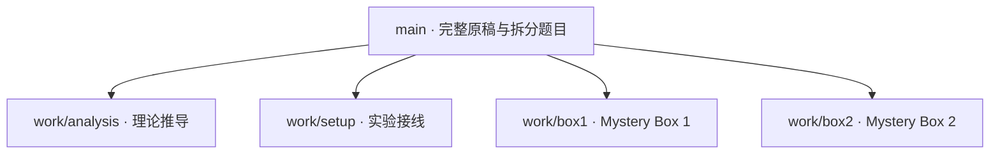

# Lab 5 Mystery Box Challenge — Group 35

Members: Tong Su, Carter Flynn Swanson, Zachary Kramer. Leader and task owners remain unassigned.

## 原始 Word

[下载完整的 Group 35 Word](original/ENGR202_Lab5_Group35.docx)。保留原文件内容、图片、表格和排版；没有填入虚构测量值。

## 分支树

四个工作分支从同一份基础版本创建，各自保留修改记录。下面是分支结构图；分支内后续提交请打开 [Branches](https://github.com/TONGSUOregonState/Lab5/branches) 查看。

| 工作部分 | 题目范围 | 编辑入口 |
|---|---|---|
| 小组信息与背景 | Q1.1 | [团队信息](sections/00-team-background.md) |
| 理论推导 | Q3.1.1–Q3.1.3 | [analysis 分支](https://github.com/TONGSUOregonState/Lab5/tree/work/analysis/sections/01-analysis.md) |
| 接线与照片 | Q3.2.1 | [setup 分支](https://github.com/TONGSUOregonState/Lab5/tree/work/setup/sections/02-setup.md) |
| Mystery Box 1 | Q3.3.1–Q3.3.12 | [box1 分支](https://github.com/TONGSUOregonState/Lab5/tree/work/box1/sections/03-box1.md) |
| Mystery Box 2 | Q3.4.1–Q3.4.12 | [box2 分支](https://github.com/TONGSUOregonState/Lab5/tree/work/box2/sections/04-box2.md) |

## 怎么使用

1. 打开自己的工作分支，编辑对应的 sections 文件；TODO 处填写过程、答案和证据链接。分工由组员自行决定。
2. 照片和示波器截图放在 evidence/setup、evidence/box1 或 evidence/box2。LTspice 文件放在 simulations 对应目录。
3. 每完成一部分提交一次，并用清楚的提交说明记录改了什么。
4. 从工作分支发起 Pull Request 到 main，检查后合并。不同文本段落可能自动合并；同段冲突需要人工处理。
5. 最后把审核通过的内容填回原 Word，另存到 final。当前没有配置自动生成或自动合并 Word。

## 提交前检查

- [ ] 小组组长、日期、实验全名填写完整
- [ ] 理论推导展示过程，额外加分项单独标明
- [ ] 接线实拍与 TinkerCAD 图齐全
- [ ] 两个盒子的双游标截图及测量窗口齐全
- [ ] 分别记录三个实际测试频率、相量、元件类型和数值
- [ ] 元件反算与回代验证齐全
- [ ] LTspice 幅值比和相位与实验明确比较
- [ ] 两个盒子的频率表和讨论齐全
- [ ] 最终 Word 检查图片、公式、表格、分页

拆分的是可合并的 Markdown 工作稿，并非四份独立 Word。图片与原排版以 original 中的完整 Word 为准。原模板存在若干笔误（例如 Q3.4.8、Q3.4.10 写 Box #1）；摘录保留原文，提交前按所在章节核实。
