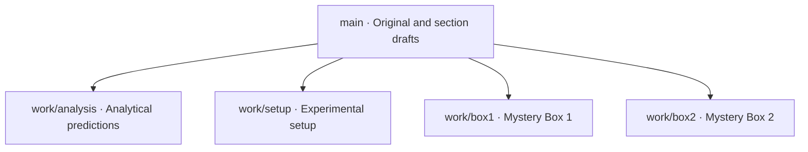

# Lab 5 Mystery Box Challenge — Group 35

Members: Tong Su, Carter Flynn Swanson, Zachary Kramer. Leader and task owners remain unassigned.

## Original Word Document

[Download the complete Group 35 Word document](original/ENGR202_Lab5_Group35.docx). The original content, images, tables, and formatting are preserved. No fabricated measurements have been added.

## Complete Question Dependency Tree

This is **one connected graph containing all 29 numbered questions**, from the lab starting point to the final Word report. The two shaded box areas are parts of the same graph, not separate diagrams.

**Read the arrows:** all incoming solid arrows are required inputs. Dashed arrows into the formula selector mean **R OR C OR L**, selected after identifying the box; they do not mean all three formulas are needed for one box. Dashed arrows into the final review are optional extra-credit contributions. Multiple incoming arrows show where results must converge.

**Colors:** blue = derivations drafted on `work/analysis`, pending team review; amber = work can start now (Q3.2.1 can be drafted, but its photo needs the physical circuit); gray = awaiting measurements or upstream results. This is a recorded status snapshot, not automatic experiment tracking.

```mermaid
flowchart TD
    START["Lab 5 · Group 35"]
    TEAM["Q1.1 · Team details"]
    R["Q3.1.1 · Resistor derivation"]
    C["Q3.1.2 · Capacitor derivation"]
    L["Q3.1.3 · Inductor derivation"]
    SETUP["Build and verify the circuit"]
    PHOTO["Q3.2.1 · Photo and TinkerCAD"]
    FORMULA["Use the matching R, C, or L formula"]
    START --> TEAM
    START --> R
    START --> C
    START --> L
    START --> SETUP
    SETUP --> PHOTO
    R -.-> FORMULA
    C -.-> FORMULA
    L -.-> FORMULA

    subgraph BOX1["Mystery Box 1"]
        direction TB
        B11["Q3.3.1 · Identify component type"]
        B12["Q3.3.2 · Baseline cursor captures"]
        B13["Q3.3.3 · Baseline phasors"]
        B14["Q3.3.4 · Value and back-substitution"]
        B15["Q3.3.5 · Resistor voltage check · EC"]
        B16["Q3.3.6 · LTspice comparison"]
        B17["Q3.3.7 · Half-frequency measurements"]
        B18["Q3.3.8 · Half-frequency component value"]
        B19["Q3.3.9 · Double-frequency measurements"]
        B110["Q3.3.10 · Double-frequency component value"]
        B111["Q3.3.11 · Compare three component estimates"]
        B112["Q3.3.12 · Gain table and discussion"]
        B12 --> B13
        B11 --> B14
        B13 --> B14
        B14 --> B15
        B13 --> B15
        B14 --> B16
        B13 --> B16
        B12 --> B17
        B12 --> B19
        B17 --> B18
        B14 --> B18
        B19 --> B110
        B14 --> B110
        B14 --> B111
        B18 --> B111
        B110 --> B111
        B13 --> B112
        B17 --> B112
        B19 --> B112
    end

    subgraph BOX2["Mystery Box 2"]
        direction TB
        B21["Q3.4.1 · Identify component type"]
        B22["Q3.4.2 · Baseline cursor captures"]
        B23["Q3.4.3 · Baseline phasors"]
        B24["Q3.4.4 · Value and back-substitution"]
        B25["Q3.4.5 · Resistor voltage check · EC"]
        B26["Q3.4.6 · LTspice comparison"]
        B27["Q3.4.7 · Half-frequency measurements"]
        B28["Q3.4.8 · Half-frequency component value"]
        B29["Q3.4.9 · Double-frequency measurements"]
        B210["Q3.4.10 · Double-frequency component value"]
        B211["Q3.4.11 · Compare three component estimates"]
        B212["Q3.4.12 · Gain table and discussion"]
        B22 --> B23
        B21 --> B24
        B23 --> B24
        B24 --> B25
        B23 --> B25
        B24 --> B26
        B23 --> B26
        B22 --> B27
        B22 --> B29
        B27 --> B28
        B24 --> B28
        B29 --> B210
        B24 --> B210
        B24 --> B211
        B28 --> B211
        B210 --> B211
        B23 --> B212
        B27 --> B212
        B29 --> B212
    end

    SETUP --> B11
    SETUP --> B12
    SETUP --> B21
    SETUP --> B22
    FORMULA --> B14
    FORMULA --> B24
    REVIEW["Assemble and review the final Word report"]
    TEAM --> REVIEW
    PHOTO --> REVIEW
    R --> REVIEW
    C --> REVIEW
    L --> REVIEW
    B16 --> REVIEW
    B111 --> REVIEW
    B112 --> REVIEW
    B26 --> REVIEW
    B211 --> REVIEW
    B212 --> REVIEW
    B15 -.-> REVIEW
    B25 -.-> REVIEW
    REVIEW --> FINAL["Final report ready for submission"]

    classDef drafted fill:#dbeafe,stroke:#2563eb,color:#172554
    classDef ready fill:#fef3c7,stroke:#b45309,color:#451a03
    classDef pending fill:#f1f5f9,stroke:#64748b,color:#0f172a
    class R,C,L drafted
    class TEAM,SETUP,PHOTO ready
    class B11,B12,B13,B14,B15,B16,B17,B18,B19,B110,B111,B112,B21,B22,B23,B24,B25,B26,B27,B28,B29,B210,B211,B212,REVIEW,FINAL pending
```

### Parallel work and convergence

- Q1.1, all three Q3.1 derivations, and circuit preparation can start independently. The three derivations are already available as a [worked PDF](https://github.com/TONGSUOregonState/Lab5/blob/work/analysis/analysis/Lab5_Analytical_Predictions.pdf).
- The Box 1 and Box 2 paths are independent once the setup is available. With only one ADALM2000, schedule measurement sessions sequentially; calculations and report writing can still overlap.
- For each box, identification and baseline captures can use the same measurement session. Q3.x.3, Q3.x.7, and Q3.x.9 can proceed after baseline capture and selection of the baseline frequency.
- Q3.x.4 combines the identified type, baseline phasors, and the matching theoretical equation. Q3.x.5 and Q3.x.6 then use both the estimated component and baseline measurements.
- Q3.x.8 and Q3.x.10 combine new measurements with the model validated in Q3.x.4. They are independent of each other. Collecting their data does not need to wait for the LTspice comparison.
- Q3.x.11 requires **all three component estimates**: Q3.x.4 + Q3.x.8 + Q3.x.10.
- Q3.x.12 requires **all three frequency datasets**: Q3.x.3 + Q3.x.7 + Q3.x.9. It can be written alongside Q3.x.11 and does not require the extra-credit check.
- Q3.2.1 documents the setup; completing its TinkerCAD illustration is not a prerequisite to collecting measurements from an already verified circuit.

Here `x=3` means Box 1 and `x=4` means Box 2. Record the actual frequencies. The plan interprets the two additional settings as half and double the baseline frequency, consistent with the instruction to test two additional frequencies; the worksheet's phrase “used previously” should be clarified with the instructor if needed. Each box may use its own baseline frequency.

The graph describes information dependencies, not a compulsory question-number order. A node can be prepared before its prerequisites are complete, but its final answer needs the indicated inputs. All required questions feed the final review directly or through downstream nodes. Q3.3.5 and Q3.4.5 are optional; the resistor-voltage entries inside Q3.3.3 and Q3.4.3 are also marked extra credit in the worksheet.

## Branch Tree

Four work branches start from the same baseline and retain their own revision histories. This diagram shows the branch structure. Visit [Branches](https://github.com/TONGSUOregonState/Lab5/branches) to view subsequent work.

| Work area | Questions | Editing location |
|---|---|---|
| Team information and background | Q1.1 | [Team information](sections/00-team-background.md) |
| Analytical predictions | Q3.1.1–Q3.1.3 | [Analysis branch](https://github.com/TONGSUOregonState/Lab5/tree/work/analysis/sections/01-analysis.md) |
| Setup and photographs | Q3.2.1 | [Setup branch](https://github.com/TONGSUOregonState/Lab5/tree/work/setup/sections/02-setup.md) |
| Mystery Box 1 | Q3.3.1–Q3.3.12 | [Box 1 branch](https://github.com/TONGSUOregonState/Lab5/tree/work/box1/sections/03-box1.md) |
| Mystery Box 2 | Q3.4.1–Q3.4.12 | [Box 2 branch](https://github.com/TONGSUOregonState/Lab5/tree/work/box2/sections/04-box2.md) |

## Workflow

1. Open your work branch and edit the corresponding file in `sections`. Replace TODO placeholders with calculations, responses, and evidence links. Team members decide task ownership.
2. Place photographs and oscilloscope screenshots in `evidence/setup`, `evidence/box1`, or `evidence/box2`. Place LTspice files in the matching `simulations` directory.
3. Commit each completed portion with a clear description of the changes.
4. Open a pull request from your work branch to `main` for review and merging. Changes to separate text sections may merge automatically; overlapping conflicts require manual resolution.
5. Transfer the reviewed content into the original Word template and save the final report in `final`. Automatic Word generation and merging are not configured.

## Submission Checklist

- [ ] Complete the group leader, date, and full lab title
- [ ] Show analytical derivations and identify extra-credit work
- [ ] Include setup photographs and the TinkerCAD layout
- [ ] Include both cursor screenshots and measurement windows for each box
- [ ] Record three actual test frequencies, voltage phasors, component types, and values for each box
- [ ] Show component calculations and verification by substitution
- [ ] Explicitly compare LTspice amplitude ratios and phases with experimental measurements
- [ ] Complete the frequency tables and discussions for both boxes
- [ ] Check images, equations, tables, and pagination in the final Word report

The section files are mergeable Markdown drafts, not four separate Word documents. Refer to the complete Word document in `original` for figures and original formatting. The supplied template contains apparent typos, including references to Box #1 in Q3.4.8 and Q3.4.10. Extracts preserve the original wording; verify these references against their section before submission.
